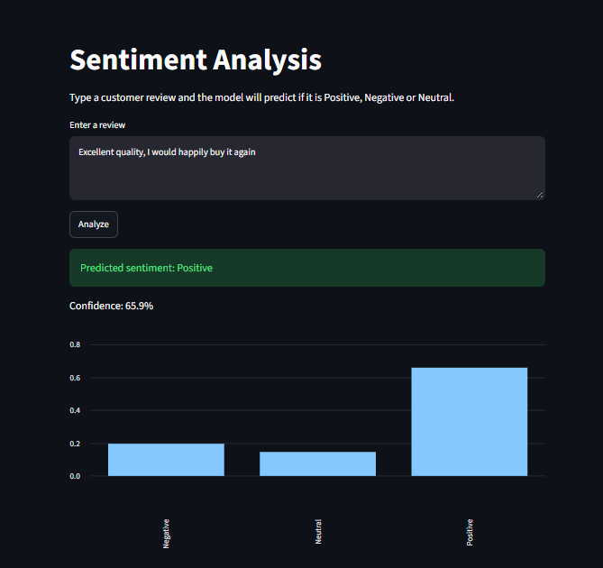
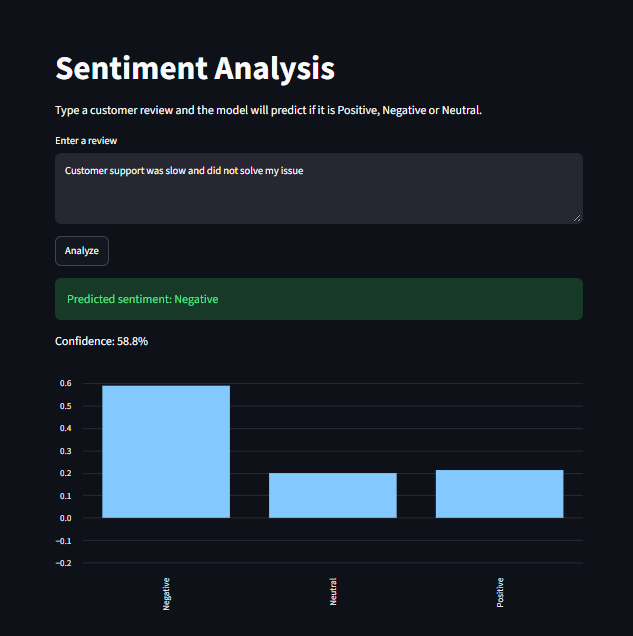
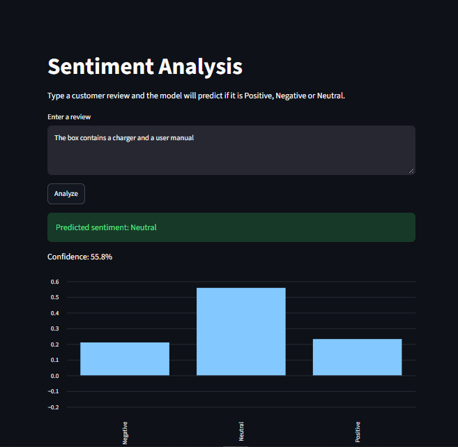

# AI-Powered Sentiment Analysis System

A beginner NLP + machine learning project (Month 2). It reads a customer review and predicts whether the sentiment is **Positive**, **Negative** or **Neutral**. The final model is available through a small Streamlit app.

## Dataset

`reviews.csv` has 10,000 reviews with these columns: `review_id`, `review_text`, `sentiment` (target), `category`, `source`.

**Limitations of the dataset**
- Only **300 of the 10,000 review texts are unique** (100 per class). The rest are repeats, so duplicate texts were removed before training. Otherwise the same review lands in both train and test.
- Even after that, the reviews are built from about 72 repeating sentences, so some test sentences also appear in training.
- Because of this the model scores almost 100%. That says the dataset is easy, not that the model will be perfect on real reviews.
- `category` and `source` are spread evenly across sentiments, so they are not used as model input.

## Workflow

1. **Cleaning:** checked missing values, empty reviews, duplicates and conflicting labels. Removed duplicate texts (10,000 -> 300 rows).
2. **EDA:** class balance, review length per class, category and source plots, common words per class.
3. **Preprocessing:** lowercasing and punctuation are handled by the vectorizer. A custom stopword list keeps "not", "no" and "never", because removing them can flip the meaning.
4. **Features:** Bag of Words and TF-IDF were compared.
5. **Models:** Logistic Regression, Multinomial Naive Bayes and Linear SVM, compared with 5-fold cross-validation.
6. **Evaluation:** accuracy, precision, recall, F1, confusion matrix and one-vs-rest ROC AUC.
7. **Tuning:** grid search (5-fold CV, macro F1) over `C` and `ngram_range`.
8. **Pipeline:** TF-IDF + Logistic Regression saved as one file with joblib.
9. **App:** Streamlit app that shows the predicted sentiment, a confidence score and a probability chart.

## Final model

TF-IDF (unigrams + bigrams) with Logistic Regression, `C=1`. Linear SVM scored about the same, but it gives no probabilities, and the app needs a confidence score.

## Results

| Check | Result |
|---|---|
| 5-fold CV macro F1 (training set, best model) | 1.00 |
| Test accuracy (60 reviews) | 1.00 |
| Precision / recall / F1 (each class) | 1.00 |
| ROC AUC (one-vs-rest) | 1.00 |

See `EVALUATION_REPORT.md` for the full comparison. These perfect scores come from the dataset limits above.

## Project files

All files are in one folder:

```
reviews.csv
sentiment_analysis.ipynb
sentiment_pipeline.pkl   (created by the notebook)
app.py
run_app.bat              (Windows shortcut to start the app)
requirements.txt
README.md
EVALUATION_REPORT.md
screenshot_positive.png
screenshot_negative.png
screenshot_neutral.png
```

## How to run

1. Install the libraries: `pip install -r requirements.txt`
2. Open `sentiment_analysis.ipynb` and run all cells. The last cells save the model as `sentiment_pipeline.pkl`.
3. Start the app from the same folder: `python -m streamlit run app.py`

On Windows you can also double-click `run_app.bat`. It uses a fixed Python path, so edit the path inside it if your Python is installed somewhere else.

## Screenshots

The app shows the predicted sentiment, a confidence score and the probability of each class.

**Positive:** "Excellent quality, I would happily buy it again"



**Negative:** "Customer support was slow and did not solve my issue"



**Neutral:** "The box contains a charger and a user manual"

